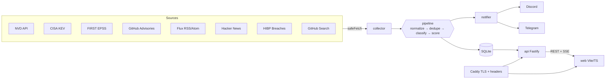
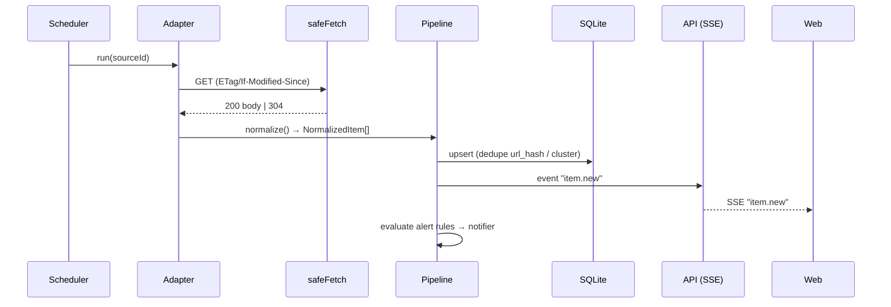

# MASTER PROMPT — Projet « Panel » (veille tech & cyber auto-hébergée)

> **À l'attention de Claude Code.** Ce document est le cahier des charges complet et définitif du projet. Toutes les décisions (produit, design, architecture, sécurité) ont été validées avec le porteur du projet. Ne les remets pas en cause. Si une information manque ou qu'une source externe a changé, choisis l'option la plus sûre et la plus simple, note-la dans `docs/DECISIONS.md`, puis continue.
>
> **Avant d'écrire du code :**
> 1. Copie ce document tel quel dans `docs/SPEC.md` à la racine du dépôt.
> 2. Crée un `CLAUDE.md` court qui renvoie à `docs/SPEC.md` et résume les règles non négociables (§ 0).
> 3. Produis un plan d'exécution par phases (§ 14) et attends mon feu vert avant la phase 1.

---

## 0. Règles non négociables (à relire avant chaque phase)

1. **La sécurité passe avant la fonctionnalité.** Tout contenu externe (flux RSS, API, URL saisie par un utilisateur) est **hostile par défaut**.
2. **Aucun `innerHTML`, `outerHTML`, `insertAdjacentHTML`, `document.write` ni `eval` dans le front.** Le DOM se construit avec `document.createElement` et `textContent`, via un helper `h()`. La CSP impose Trusted Types : toute violation casse le build.
3. **Aucun secret dans le dépôt** : `.env` ignoré, `.env.example` documenté, gitleaks en CI.
4. **SQL uniquement paramétré** (via Drizzle). Aucune concaténation de chaîne dans une requête.
5. **Toutes les requêtes HTTP sortantes** passent par le client sécurisé `safeFetch` (§ 9.3). Aucun `fetch` direct ailleurs : une règle ESLint l'interdit.
6. **Toutes les données entrantes sont validées par Zod**, côté API comme côté adaptateurs.
7. **Code, commentaires, noms de fichiers et commits en anglais.** Interface en anglais par défaut, avec une traduction française complète (bouton EN/FR).
8. **TypeScript strict partout**, `any` interdit sauf justification en commentaire.
9. **Chaque phase se termine en vert** : `pnpm lint && pnpm typecheck && pnpm test && pnpm build`. Puis un commit au format Conventional Commits.
10. **Pas de dépendance superflue.** Avant d'ajouter un paquet, vérifie sa maintenance et son nombre de dépendances, et justifie-le dans `docs/DECISIONS.md`.
11. **Pas d'IA, pas d'appel à un LLM.** Un point d'extension `Summarizer` existe (§ 7.9), mais seule l'implémentation `none` est livrée.
12. **Accessibilité WCAG 2.2 AA** : contrastes, focus visible, navigation clavier, `prefers-reduced-motion`, bouton pause sur tout ce qui bouge.

---

## 1. Vision produit

**Panel** est un tableau de bord / journal de veille technologique **auto-hébergé**, déployé par chaque utilisateur sur sa propre machine (Raspberry Pi, avec Docker Compose). Il agrège l'actualité IT (IA, cybersécurité, innovation, dev & IT, matériel) et surveille en continu les vulnérabilités (CVE), les failles exploitées (CISA KEV), les grosses fuites de données et les versions logicielles.

**Objectif secondaire, mais essentiel :** c'est un **projet de portfolio** destiné à des recruteurs. La qualité du code, de l'architecture, de la sécurité, des tests et de la documentation (README) compte autant que le résultat visuel.

**Principes UX :**
- **Synthèse d'abord, détail au clic.** Une information se comprend en 5 secondes. Le deep dive est à un clic, dans un panneau latéral.
- **Un journal vivant.** La page d'accueil est une « une » de journal avec des cases qui défilent et se renouvellent.
- **Sobre, élégant, façon Apple.** Ni néon, ni effet « hacker », ni dégradé criard.

**Périmètre utilisateur :** une instance par personne, **privée** (accès via Tailscale), protégée par une phrase de passe. Les préférences et les sources personnelles sont stockées **dans l'instance**.

---

## 2. Stack technique (imposée)

| Couche | Choix |
|---|---|
| Runtime | Node.js **LTS actuelle** (épinglée dans `.nvmrc` et `engines`) |
| Langage | TypeScript (`strict`, `noUncheckedIndexedAccess`, `exactOptionalPropertyTypes`) |
| Monorepo | **pnpm workspaces** |
| API | **Fastify** + `@fastify/helmet`, `@fastify/rate-limit`, `@fastify/cookie` |
| Base de données | **SQLite** (mode WAL) via `better-sqlite3` + **Drizzle ORM** et ses migrations |
| Validation | **Zod** (schémas partagés dans `packages/shared`) |
| Planification | `croner` |
| Parsing XML/RSS | `fast-xml-parser`, configuré de façon sûre (§ 9.4) |
| Nettoyage HTML | conversion en texte brut (`sanitize-html` avec `allowedTags: []`) |
| Contrôle des IP | `ipaddr.js` |
| Hash des mots de passe | Argon2id (`@node-rs/argon2`) |
| Logs | `pino` (celui de Fastify), avec masquage des secrets |
| Front | **Vite + TypeScript, sans framework**, en **Web Components natifs** (Custom Elements) |
| Polices | Auto-hébergées via `@fontsource` : **Hanken Grotesk**, **IBM Plex Mono**, **Newsreader**. Aucun appel à Google Fonts |
| Graphiques | SVG générés à la main (sparklines, anneaux, barres), sans librairie |
| Tests | **Vitest** (unitaires et intégration), **Playwright** (tests de bout en bout, fumée), `@axe-core/playwright` (accessibilité) |
| Qualité | ESLint (`typescript-eslint` strict + règles de sécurité), Prettier, commitlint, lefthook (pre-commit : lint-staged + gitleaks) |
| Conteneurs | Docker multi-stage, **Docker Compose**, **Caddy** (reverse proxy, TLS, en-têtes) |
| CI/CD | GitHub Actions : lint, typecheck, test, build, CodeQL, audit, Trivy, images **multi-arch (amd64 + arm64)** sur **GHCR**, démo statique sur **GitHub Pages** |

---

## 3. Architecture

### 3.1 Vue d'ensemble

```
                         GitHub (code · CI/CD · images GHCR · démo GitHub Pages)
                                              │  docker compose pull
                                              ▼
┌──────────────────────── Raspberry Pi · Docker Compose ─────────────────────────┐
│                                                                                 │
│   ┌────────────┐   écrit    ┌──────────────┐   lit     ┌──────────────┐         │
│   │ collector  │──────────► │ SQLite (WAL) │ ◄──────── │ api (Fastify)│         │
│   │ - scheduler│            │  volume data │           │ - auth       │         │
│   │ - adapters │            └──────────────┘           │ - REST + SSE │         │
│   │ - pipeline │                                       └──────┬───────┘         │
│   │ - notifier │──► Discord webhook / Telegram bot            │ réseau interne  │
│   └─────┬──────┘                                       ┌──────┴───────┐         │
│         │ HTTPS sortant (safeFetch)                    │ caddy        │◄── navigateur
│         ▼                                              │ - TLS        │   (via Tailscale)
│   APIs & flux publics                                  │ - en-têtes   │         │
│                                                        │ - front      │         │
│                                                        └──────────────┘         │
└─────────────────────────────────────────────────────────────────────────────────┘
```

### 3.2 Schéma Mermaid (à reprendre dans le README)



### 3.3 Flux d'un élément



### 3.4 Arborescence du dépôt

```
panel/
├─ apps/
│  ├─ api/                 # Fastify : auth, REST, SSE
│  │  └─ src/{routes,plugins,services,auth}/…
│  ├─ collector/           # scheduler, adaptateurs, pipeline, notifier
│  │  └─ src/{adapters,pipeline,notifier,scheduler}/…
│  └─ web/                 # Vite + TS + Web Components
│     ├─ src/{components,pages,lib,i18n,styles}/…
│     └─ demo/             # données fictives pour la démo GitHub Pages
├─ packages/
│  ├─ shared/              # types, schémas Zod, constantes, scoring, classification
│  ├─ db/                  # schéma Drizzle, migrations, seed des sources
│  └─ safe-fetch/          # client HTTP sécurisé (anti-SSRF), parseur XML sûr, nettoyage
├─ deploy/
│  ├─ docker/              # Dockerfiles (api, collector, web/caddy)
│  ├─ Caddyfile
│  ├─ compose.yaml
│  └─ scripts/{deploy.sh,backup.sh}
├─ config/
│  ├─ sources.default.json # catalogue de sources par défaut
│  └─ keywords.json        # dictionnaire de classification FR/EN
├─ docs/  SPEC.md · DECISIONS.md · ARCHITECTURE.md · SECURITY-MODEL.md · SCORING.md
├─ .github/ workflows/{ci.yml,release.yml,pages.yml,codeql.yml} · dependabot.yml
├─ SECURITY.md · README.md · LICENSE (MIT) · CLAUDE.md
└─ .env.example · .nvmrc · pnpm-workspace.yaml · lefthook.yml · eslint.config.js
```

---

## 4. Direction artistique (DA)

### 4.1 Intention
Une interface **sobre, lumineuse et précise, façon Apple** : beaucoup d'air, de grandes cases arrondies (« bento »), une typographie soignée, **un seul accent bleu**, et la couleur réservée au sens (gravité, rubrique). Le Journal ajoute une **touche presse** : titres à empattements, filets, bandeau qui défile. Le tout ne doit **pas** ressembler à un projet généré automatiquement : pas d'Inter, pas de dégradés violets, pas de glassmorphism partout, pas d'emojis dans l'interface.

### 4.2 Design tokens (fichier `apps/web/src/styles/tokens.css`, en variables CSS)

**Couleurs — thème clair (par défaut)**
```
--bg: #F5F5F7;        --card: #FFFFFF;      --text: #1D1D1F;     --sub: #6E6E73;
--border: rgba(0,0,0,.06);   --border-strong: rgba(0,0,0,.20);
--seg: rgba(0,0,0,.05);      --seg-on: #FFFFFF;   --hover: rgba(0,0,0,.035);
--track: rgba(0,0,0,.07);    --subtle: #F5F5F7;
--accent: #2E5BFF;    --accent-bg: #EDF1FF;  --accent-fg: #2440C4;
--inv: #1D1D1F;       --inv-text: #F5F5F7;   /* cases inversées : fuites, « In 60 seconds », bandeau */
--shadow-seg: 0 1px 3px rgba(0,0,0,.12);
--shadow-hover: 0 18px 40px -18px rgba(0,0,0,.22);
```
**Couleurs — thème sombre**
```
--bg: #0C0D10;  --card: #16171B;  --text: #F4F4F6;  --sub: #9C9CA6;
--border: rgba(255,255,255,.07);  --border-strong: rgba(255,255,255,.22);
--seg: rgba(255,255,255,.07);  --seg-on: #2A2B31;  --hover: rgba(255,255,255,.05);
--track: rgba(255,255,255,.09); --subtle: rgba(255,255,255,.05);
--accent: #5B7CFF;  --accent-bg: rgba(91,124,255,.16);  --accent-fg: #A9BBFF;
--inv: #F4F4F6;  --inv-text: #0C0D10;
```
**Gravité (sémantique, identique dans les deux thèmes pour les points et barres)**
```
critical: point/barre #E5484D · fond clair #FDECEC / texte #B42318 · fond sombre rgba(229,72,77,.16) / texte #FF9592
high:     point/barre #F76B15 · fond clair #FFF1E6 / texte #B54708 · fond sombre rgba(247,107,21,.16) / texte #FFA266
medium:   point/barre #C79A00 · texte clair #946F00 · texte sombre #FFC53D
low:      point/barre #8E8E93 · texte = --sub
ok/santé: #30A46C (texte clair #1E7F4F)
```
**Rubriques du Journal** (point / texte clair / texte sombre / teinte de fond claire)
```
AI          #7C66DC / #5B45B8 / #B9A9FF / #F1EEFC
Cyber       #E5484D / #B42318 / #FF9592 / #FDEEEE
Innovation  #12A594 / #0B7065 / #5DD9C8 / #E8F7F5
Dev & IT    #2E5BFF / #2440C4 / #A9BBFF / #EDF1FF
Hardware    #E38A13 / #9A4D00 / #FFC07A / #FDF3E6
```
Tout texte doit atteindre un contraste ≥ 4,5:1, vérifié par un test automatisé sur les paires de tokens.

**Typographie**
- Interface : **Hanken Grotesk** 400/500/600/700, avec `-webkit-font-smoothing: antialiased`.
- Données (CVE, versions, scores, heures, codes) : **IBM Plex Mono** 400/500.
- Titres du Journal uniquement : **Newsreader** 500/600 (axe optique activé).
- Échelle : 11 · 12.5 · 13.5 · 14 · 15.5 · 17 · 20 · 23 · 28 · 38 · 52 · 64 px.
- Titres : `letter-spacing` négatif (−0,02 em à −0,045 em selon la taille). Chiffres : `font-variant-numeric: tabular-nums`.
- Libellés « eyebrow » : Plex Mono 11–12 px, majuscules, `letter-spacing: .08em`.

**Formes et espacements**
- Rayons : cases 24–26 px, panneau latéral 28 px, champs 12–14 px, pastilles 999 px.
- Grille bento : 12 colonnes, `gap: 20px`, conteneur `max-width: 1320px`, marges 40 px (16 px sur mobile).
- Échelle d'espacement : 4 · 6 · 8 · 10 · 12 · 14 · 16 · 18 · 20 · 22 · 24 · 28 · 32 · 40 · 52.
- Cibles tactiles ≥ 44 px.

**Mouvement**
- Courbe standard `cubic-bezier(.2,.8,.2,1)`. Courbe du panneau `cubic-bezier(.2,.9,.2,1)`.
- Apparition des cases : fondu + translation de 16 px en 0,8 s, décalées de 40–60 ms l'une après l'autre.
- Survol d'une case : translation de −3 px + `--shadow-hover`, en 0,45 s.
- Compteurs : de 0 à la valeur en 1,3 s, en `easeOutCubic`. Sparklines : tracé progressif avec `stroke-dashoffset`.
- Bandeau LIVE : défilement horizontal en boucle (≈ 70 s), en pause au survol.
- « Live wire » : défilement vertical en boucle (≈ 48 s), en pause au survol, fondu en haut et en bas.
- Rotation des titres : cases de rubrique toutes les 4,5 s (décalées d'une case à l'autre), une toutes les 9 s. Transition : fondu + translation de 14 px en 0,7 s.
- Badge KEV : halo rouge qui pulse toutes les 2,4 s.
- **Bouton Pause global** dans l'en-tête du Journal (WCAG 2.2.2). `prefers-reduced-motion: reduce` → aucune animation, rotation arrêtée.

**Iconographie** : SVG en trait de 2 px, coins arrondis, dessinés en interne (`apps/web/src/components/icons.ts`). Pas d'emoji.

**Logo « Panel »** : carré arrondi de 28 px (rayon 8) couleur `--text`, contenant trois blocs façon bento. Bloc gauche 7×16, deux blocs droits 7×7, couleur `--bg` ; le bloc en bas à droite est en `--accent`. Il est suivi du mot « Panel » en Hanken Grotesk 700, 19 px, `letter-spacing: -0.02em`.

### 4.3 Maquettes (wireframes de référence)

Des maquettes interactives haute fidélité existent dans un canevas de design. Reproduis fidèlement ces wireframes et la DA ci-dessus.

#### A. Journal — page d'accueil (`/`)
```
┌────────────────────────────────────────────────────────────────────────────────────┐
│● LIVE │ CYBER CVE-2026-41234 (PHP) added to CISA KEV │ AI A 3B open model… │ DEV …  ⟶ │  ← bandeau inversé, défile
├────────────────────────────────────────────────────────────────────────────────────┤
│ ▣ Panel  ( Journal | Brief | Threats | Breaches | Releases )      [⏸ Pause] [◐] [EN|FR] [⚙] │
│                                                                                    │
│━━━━━━━━━━━━━━━━━━━━━━━━━━━━━━━━━━━━━━━━━━━━━━━━━━━━━━━━━━━━━━━━━━━━━━━━━━━━━━━━━━━━━│  ← filet 2 px
│ MONDAY 2 NOVEMBER 2026          The Daily Brief               UPDATED 21:14        │  ← Newsreader 64 px
│ EDITION № 214 · ARLES                                         [⌘K Search]          │
│────────────────────────────────────────────────────────────────────────────────────│
│ (● All) (● AI) (● Cyber) (● Innovation) (● Dev & IT) (● Hardware)                  │  ← filtres
│                                                                                    │
│ ┌──────────────────────────────────────────────┬──────────┐ ┌───────────────────┐  │
│ │ FRONT PAGE · AI                              │ ⠿⠿⠿⠿⠿⠿⠿⠿ │ │ ● Live wire       │  │
│ │ Small open models now summarise the news     │ ⠿ motif  │ │ 21:12 CYBER       │  │
│ │ offline on an €80 board          (serif 38)  │ ⠿ génératif│ │ CISA adds CVE-…   │  │
│ │ Chapô 2–3 lignes en --sub…                   │ ⠿⠿⠿⠿⠿⠿⠿⠿ │ │ ───────────────── │  │
│ │ Ars Technica [EN] 2h        · 3 sources      │ ━ ● ● ●  1/4│ │ 21:04 DEV & IT    │  │
│ └──────────────────────────────────────────────┴──────────┘ │ …  (défile ↑)     │  │
│ ┌─────────────────────┐ ┌─────────────────────┐             │                   │  │
│ │ ■ AI           2/4  │ │ ■ CYBER        1/4  │             │                   │  │
│ │ Titre serif 23 px   │ │ Titre serif 23 px   │             │                   │  │
│ │ (tourne en fondu)   │ │                     │             │                   │  │
│ │ Next [FR] 1h        │ │ CERT-FR [FR] 2h     │             │                   │  │
│ │ ━ ● ● ●             │ │ ━ ● ● ●             │             │                   │  │
│ └─────────────────────┘ └─────────────────────┘             └───────────────────┘  │
│ ┌─────────────────────┐ ┌─────────────────────┐ ┌─────────────────────┐            │
│ │ ■ INNOVATION        │ │ ■ DEV & IT          │ │ ■ HARDWARE          │            │
│ └─────────────────────┘ └─────────────────────┘ └─────────────────────┘            │
│ ┌──────────────────────────────────┐ ┌──────────────────────────────────┐          │
│ │ In 60 seconds  (case inversée)   │ │ Threat snapshot                  │          │
│ │ 01 CYBER Patch PHP now…          │ │ [214 New] [9 Crit] [2 KEV] [5 WL]│          │
│ │ 02 …  (5 lignes)                 │ │ ▸ CVE-2026-41234 · KEV      9.8  │          │
│ └──────────────────────────────────┘ │ Open the Brief →                 │          │
│                                      └──────────────────────────────────┘          │
│ footer : sources + attribution HIBP (CC BY 4.0)                                    │
└────────────────────────────────────────────────────────────────────────────────────┘
```
- Une : s8 (8 colonnes sur 12), coupée en deux (texte 1,25 fr / visuel 1 fr). Le visuel est une **grille de points 8×8 générative** dont la taille et l'opacité dépendent de l'article affiché, sur la teinte de la rubrique. Des points cliquables (l'actif est allongé à 26 px) et un compteur « 1/4 ».
- Live wire : s4, sur deux rangées, hauteur ≈ 760 px, avec un masque en fondu. Il reçoit les nouveaux éléments **en direct (SSE)**, insérés en haut avec une animation.
- Cases de rubrique : 4 titres chacune, rotation décalée, points cliquables. Un filtre de rubrique ne garde que la case concernée et filtre le fil en direct.
- La une choisit les 4 meilleurs articles **de rubriques différentes** (§ 7.7).
- Le badge « N sources » apparaît quand un regroupement contient plus d'un article.

#### B. Brief — tableau de bord cyber (`/brief`)
```
┌────────────────────────────────────────────────────────────────────────────┐
│ MONDAY, NOVEMBER 2 · 21:14                                                 │
│ Good evening, Pierre.                         (52 px, 600, -0.04em)        │
│ 14 new items since your last visit. 2 need your attention.                 │
│                                                                            │
│ ┌ New CVEs·24h ┐ ┌ Critical ┐ ┌ Exploited ┐ ┌ Watchlist ┐   ← 4 cases s3     │
│ │ 214  ▁▃▂▅▇▄▆ │ │ 9 ▁▁▂▁▃▁ │ │ 2  ▁▁▁▁▂ │ │ 5  ▁▂▁▃▁ │     compteur animé    │
│ │ +18% vs 7d   │ │ +3       │ │ CISA KEV  │ │ PHP, SSH… │     + sparkline       │
│ └──────────────┘ └──────────┘ └───────────┘ └───────────┘                  │
│ ┌──────────────── Priority queue (s8, 2 rangées) ──┐ ┌ Your watchlist ──┐  │
│ │ ▌CVE-2026-41234 [● Exploited] [PHP]   CVSS 9.8   │ │ PHP     ███ 1    │  │
│ │ ▌PHP · Remote code execution     ▬▬▬ EPSS 94%·2h │ │ Linux   ███ 1    │  │
│ │ ▌Fixed in 8.3.14 and 8.2.27                      │ │ Node.js     0    │  │
│ │ … 5 lignes, clic → panneau latéral               │ └──────────────────┘  │
│ │                          View all threats →      │ ┌ Latest breach ───┐  │
│ └──────────────────────────────────────────────────┘ │ (case inversée)  │  │
│ ┌ Top stories ─────┐ ┌ Trending on GitHub ┐ ┌ Releases ┐│ 12.4M accounts   │  │
│ └──────────────────┘ └────────────────────┘ └──────────┘│ Source: HIBP ↗   │  │
│                                                         └──────────────────┘  │
└────────────────────────────────────────────────────────────────────────────┘
```

#### C. Panneau de détail d'une CVE (sur le Brief, `/threats` ou `/threats/:cveId`)
```
                     ┌──────────────────────────────────────────────┐
  (fond assombri     │ CVE-2026-41234                  [NVD ↗] [✕] │
   + flou 8 px,      │ PHP — Remote code execution      (30 px)     │
   clic = fermer)    │ [Critical · 9.8] [● Exploited · KEV] [Watchlist · PHP] │
                     │ ┌ TL;DR ───────────────────────────────────┐ │
                     │ │ Synthèse générée par template (§ 7.8)    │ │
                     │ └──────────────────────────────────────────┘ │
                     │ ┌ anneau CVSS ┐ ┌ EPSS 94% ▬▬ ┐ ┌ Patch      ┐ │
                     │ │    9.8      │ │ proba 30 j  │ │ deadline   │ │
                     │ └─────────────┘ └─────────────┘ │ Nov 23     │ │
                     │ [Attack vector Network AV:N] [Complexity Low AC:L] │
                     │ [Privileges None PR:N] [User interaction None UI:N] │
                     │ Affected versions   8.1.x · 8.2.0–8.2.26 …   │
                     │ Fix                 8.3.14 · 8.2.27          │
                     │ Weakness            CWE-787 · Out-of-bounds… │
                     │ Timeline  ●────●────●  Published/KEV/Modified│
                     │ References  NVD record [NVD] · Vendor [Vendor]│
                     │             CISA KEV [KEV] · Public exploit [Exploit] │
                     │ In the news (3) → articles liés              │
                     │ [‹ Previous]          2 / 5        [Next ›]  │
                     └──────────────────────────────────────────────┘
```
- Il glisse depuis la droite (0,55 s), avec une marge de 12 px aux bords et une largeur de `min(540px, 100% - 24px)`. Sur mobile, il occupe tout l'écran et se ferme en glissant vers le bas.
- `role="dialog"`, `aria-modal="true"`, **focus piégé** à l'intérieur, `Esc` ferme, le focus revient à l'élément d'origine.
- Raccourcis (désactivés quand le focus est dans un champ) : `j`/`k` suivant/précédent, `Enter` ouvrir, `Esc` fermer, `s` sauvegarder, `o` ouvrir la source, `/` ou `⌘K`/`Ctrl K` palette de recherche.
- Le lien direct `/threats/CVE-2026-41234` rouvre le panneau : c'est le lien envoyé par les bots.

#### D. Paramètres (`/settings`)
```
Settings  (48 px)                   ( Sources | Watchlist | Alerts | Display | Data )
┌──────────────── Sources (s8) ─────────────────────┐ ┌ Watchlist (s4) ─────────┐
│ SECURITY                                          │ │ (PHP)(Node.js)(Python)  │
│ NVD [API][EN]  CVE details…     ● Healthy  [◯━]   │ │ (Linux)(Docker)(OpenSSH)│
│ CISA KEV [JSON][EN]             ● Healthy  [◯━]   │ │ (WordPress)(Browsers)   │
│ …                                                 │ │ (Routers) (+ Add)       │
│ TECH & CULTURE                                    │ └─────────────────────────┘
│ Next [RSS][FR]                  ● Slow · 4.1 s    │ ┌ Alerts ─────────────────┐
│ CUSTOM · PRIVATE                                  │ │ CVSS at least   ━━●━ 9.0│
│ korben.info [RSS][FR]  Added by you  ● Healthy    │ │ EPSS at least   ━●━━ 50%│
└───────────────────────────────────────────────────┘ │ Breach ≥ 1.0M accounts  │
┌ Add a custom source ──────────────────────────────┐ │ HN score ≥ 500 pts      │
│ Feed URL [https://…              ] [Test feed ⟳]  │ │ Discord ● Connected     │
│ ✓ HTTPS only                    │ Preview         │ │ Telegram ● Connected    │
│ ✓ Public IP, private ranges     │ • item 1        │ │ Quiet hours 23:00–07:00 │
│   blocked                       │ • item 2        │ │ Digest 08:00            │
│ ✓ Valid RSS 2.0 · 20 items      │ • item 3        │ │ [Send a test alert]     │
│ ✓ 48 KB in 312 ms               │ [Add to my sources] └─────────────────────────┘
└───────────────────────────────────────────────────┘
```
- Les interrupteurs sont de vrais `<button role="switch" aria-checked>`, avec un bouton qui glisse en ressort (0,35 s, `cubic-bezier(.3,1.4,.5,1)`).
- « Test feed » : chargement, puis appel `POST /api/sources/validate`, puis affichage des contrôles réellement passés et de l'aperçu. « Add » n'est actif qu'après une validation réussie.
- Un toast confirme les actions (« Test alert sent… ») et disparaît après 2,6 s (`role="status"`).
- Onglet **Display** : thème (Système/Clair/Sombre), langue, densité (Confortable/Compacte), réduction des animations, prénom affiché dans le message d'accueil.
- Onglet **Data** : export/import JSON de la configuration (préférences, watchlist, sources perso, sans secret), purge du cache, téléchargement d'une sauvegarde de la base.

#### E. Mobile (< 640 px)
```
┌──────────────────────────┐
│ ▣ Panel        [⌕] [EN]  │
│ MONDAY, NOVEMBER 2       │
│ Good evening, Pierre.    │
│ ┌ New CVEs ┐┌ Critical ┐ │
│ │ 214      ││ 9        │ │
│ └──────────┘└──────────┘ │
│ ┌ Exploited┐┌ Watchlist┐ │
│ └──────────┘└──────────┘ │
│ ┌ Priority queue ──────┐ │
│ │ ▌CVE-… ● PHP · RCE 9.8│ │
│ └──────────────────────┘ │
│ ┌ Latest breach (inv.)─┐ │
│ └──────────────────────┘ │
│╭────────────────────────╮│
││Journal Brief Threats ⚙ ││ ← barre d'onglets flottante, floutée
│╰────────────────────────╯│
└──────────────────────────┘
```
Sur mobile, le Journal empile ses cases : une, puis Live wire (hauteur réduite à 420 px), puis les rubriques. Les menus passent à la ligne, les tableaux défilent dans leur boîte.

#### F. Autres écrans
- **`/setup`** (premier lancement uniquement) : choix d'une phrase de passe (≥ 12 caractères, indicateur de robustesse), du prénom affiché et de la langue.
- **`/login`** : une seule case centrée avec le logo, le champ phrase de passe et le bouton « Unlock ». Message d'erreur générique.
- **`/threats`** : liste complète, filtres en pastilles cumulables (All, KEV, Watchlist, Critical, High, technologies), tri (Priority, Newest, CVSS, EPSS), vue Compacte ou Cartes, filtres reflétés dans l'URL, pagination infinie.
- **`/breaches`, `/releases`** : listes simples dans le même style.
- **Palette de recherche** (`⌘K`) : modale centrée, recherche plein texte (SQLite FTS5) dans les CVE, articles, dépôts et versions, plus des commandes (`>theme dark`, `>sync`, `>pause`).
- **États obligatoires** pour chaque vue : squelettes animés au chargement (jamais un spinner seul), état vide avec un message positif, bandeau « Showing data from 2h ago — source unreachable » hors ligne, badge d'erreur par source dans les Paramètres.

---

## 5. Internationalisation

- Fichiers `apps/web/src/i18n/en.json` et `fr.json`. Une clé manquante en FR fait échouer un test.
- Langue par défaut : EN. Le choix est sauvegardé dans les préférences de l'instance (mis en cache en LocalStorage).
- Dates via `Intl.DateTimeFormat` et `Intl.RelativeTimeFormat` ; nombres via `Intl.NumberFormat` (12.4M ↔ 12,4 M).
- **Le contenu des articles n'est pas traduit** : il reste dans sa langue d'origine, avec un badge `EN`/`FR`.
- Les synthèses de CVE (§ 7.8) et les libellés du vecteur CVSS sont générés à partir de templates présents **dans les deux langues**.

---

## 6. Sources de données

Toutes les URL sont dans `config/sources.default.json`. **À l'implémentation, vérifie que chaque URL répond.** Si une URL a changé, cherche la nouvelle sur le site officiel ; si une source a disparu, désactive-la et note-le dans `docs/DECISIONS.md`.

### 6.1 Sécurité
| id | Source | URL / endpoint | Fréquence | Notes |
|---|---|---|---|---|
| `cisa-kev` | CISA KEV | `https://www.cisa.gov/sites/default/files/feeds/known_exploited_vulnerabilities.json` | 1 h | Requête conditionnelle ; nouveautés détectées par différence sur `dateAdded` |
| `nvd` | NVD CVE API 2.0 | `https://services.nvd.nist.gov/rest/json/cves/2.0` | 2 h | Clé dans l'**en-tête** `apiKey` (`NVD_API_KEY`). Incrémental via `lastModStartDate`/`lastModEndDate` (fenêtre ≤ 120 jours), `resultsPerPage` ≤ 2000, pagination `startIndex`, pause ≥ 2 s entre pages (6 s sans clé) |
| `epss` | FIRST EPSS | `https://api.first.org/data/v1/epss?cve=CVE-…,CVE-…` | 1 fois par jour (+ à l'arrivée de nouvelles CVE) | Par lots de CVE ; on stocke `epss` et `percentile` |
| `ghsa-*` | GitHub Advisory DB | `https://api.github.com/advisories?ecosystem={composer,npm,pip}&per_page=100` | 1 h | Token `GITHUB_TOKEN` en lecture seule ; liaison aux CVE via `cve_id` |
| `cert-fr-alertes` / `cert-fr-avis` | CERT-FR (ANSSI) | flux RSS des alertes et des avis sur `cert.ssi.gouv.fr` | 30 min | FR ; les **alertes** peuvent déclencher une notification, les avis non |
| `hibp` | Have I Been Pwned | `https://haveibeenpwned.com/api/v3/breaches` | 6 h | User-Agent obligatoire ; nouveautés par différence sur `AddedDate` ; **affichage obligatoire de l'attribution « Source: Have I Been Pwned » avec lien (CC BY 4.0)** |

### 6.2 Actualité, culture, versions
| id | Source | URL | Fréquence | Rubrique par défaut |
|---|---|---|---|---|
| `hn` | Hacker News | `https://hacker-news.firebaseio.com/v0/topstories.json` + `/v0/item/{id}.json` (30 premiers, cache par id) | 15 min | Dev & IT |
| `lobsters` | Lobsters | `https://lobste.rs/hottest.json` | 1 h | Dev & IT |
| `devto` | DEV | `https://dev.to/api/articles?top=1&per_page=30` | 1 h | Dev & IT |
| `gh-trending` | GitHub Search | `https://api.github.com/search/repositories?q=created:>{J-7}&sort=stars&order=desc&per_page=30` | 6 h | Dev & IT (+ historique d'étoiles pour le « +X today ») |
| `bleeping` | BleepingComputer | RSS | 30 min | Cyber |
| `thehackernews` | The Hacker News | RSS | 30 min | Cyber |
| `arstechnica` | Ars Technica | RSS | 30 min | Innovation |
| `theregister` | The Register | Atom | 30 min | Dev & IT |
| `theverge` | The Verge | RSS | 30 min | Innovation |
| `ieee-spectrum` | IEEE Spectrum | RSS | 1 h | Innovation |
| `tomshardware` | Tom's Hardware | RSS | 1 h | Hardware |
| `next` | Next (FR) | RSS | 30 min | Dev & IT |
| `korben` | Korben (FR) | RSS | 1 h | Dev & IT |
| `lmi` | Le Monde Informatique (FR) | RSS | 1 h | Dev & IT |
| `rel-php` | php.net releases | flux officiel | 1 h | Version (sécurité si le flux l'indique) |
| `rel-node` | Node.js releases | flux officiel | 1 h | Version |
| `rel-python` | Python Insider | flux officiel | 6 h | Version |
| `rel-docker` | moby/moby | `https://github.com/moby/moby/releases.atom` | 6 h | Version |

**Interdits :** l'API Reddit (accès non authentifié coupé en 2026) et l'offre gratuite de NewsAPI.org (réservée au développement).

### 6.3 Watchlist par défaut
PHP, Node.js/npm, Python, Linux, Docker, OpenSSH, WordPress, Browsers (Chrome/Firefox/Safari), Routers (dont Freebox). Chaque entrée a des `keywords` (correspondance dans les titres et descriptions) et des `cpe_patterns` (correspondance avec les configurations CPE de NVD).

---

## 7. Logique métier

### 7.1 Interface des adaptateurs
```ts
export interface SourceAdapter<Raw = unknown> {
  id: string;
  kind: 'cve' | 'article' | 'breach' | 'release' | 'repo';
  schedule: string;                                   // cron, appliqué avec un décalage aléatoire de ±10 %
  fetch(ctx: FetchContext): Promise<FetchResult<Raw>>; // via safeFetch ; gère ETag/Last-Modified
  normalize(raw: Raw, ctx: NormalizeContext): NormalizedItem[]; // validé par un schéma Zod
}
```
Un **adaptateur RSS/Atom générique** sert à tous les flux, y compris les sources perso. Chaque adaptateur a des **fixtures** enregistrées (`__fixtures__/`) et des tests.

### 7.2 Pipeline
`fetch → parse → normalize → enrich → dedupe → cluster → classify → score → store → emit (SSE) → alert`

- **Enrichissement :** extraction des CVE dans le texte (`/\bCVE-\d{4}-\d{4,7}\b/g`, motif borné, sans risque de ReDoS) et remplissage de la table `item_cves`. Pour une CVE, fusion des données NVD, KEV, EPSS et GHSA.
- **Dédoublonnage strict :** URL canonique (minuscules, suppression de `utm_*`, `fbclid`, `gclid`, `ref`, de l'ancre et du `/` final), puis `url_hash = sha256`. Contrainte `UNIQUE`.
- **Regroupement :** titre normalisé (minuscules, sans accents ni ponctuation, mots vides FR/EN retirés), puis similarité de Jaccard sur des trigrammes de mots ≥ 0,8 dans une fenêtre de 48 h → même `cluster_id`.

### 7.3 Ordonnancement et résilience
- Une requête à la fois par domaine, 4 au maximum en tout.
- Réessai progressif sur 429/5xx/timeout : 3 tentatives, avec un délai qui double (base 2 s, plafond 60 s, part aléatoire), en respectant `Retry-After`.
- **Disjoncteur :** 5 échecs consécutifs → source « degraded » ; le délai entre tentatives passe à ×4, jusqu'à un maximum de 6 h. Retour à la normale au premier succès.
- Chaque exécution est journalisée dans `fetch_runs` (alimente `/api/health` et la page Paramètres).
- `User-Agent: Panel/<version> (+https://github.com/<owner>/panel)`.

### 7.4 Modèle de données (Drizzle / SQLite)
```sql
sources(id TEXT PK, name, kind, adapter, url, lang, category_default, schedule,
        enabled INT, is_custom INT, weight REAL DEFAULT 1, etag, last_modified,
        health TEXT, consecutive_failures INT, created_at, updated_at)
fetch_runs(id PK, source_id FK, started_at, finished_at, status, http_status,
           items_new INT, bytes INT, duration_ms INT, error TEXT)
items(id PK, source_id FK, kind, url, url_hash UNIQUE, title, summary, lang,
      author, published_at, fetched_at, category, tags_json, cluster_id,
      rank_score REAL, hn_points INT, extra_json)
items_fts  -- table virtuelle FTS5 (title, summary)
cves(cve_id PK, description_en, cvss REAL, cvss_version, vector, severity,
     epss REAL, epss_percentile REAL, epss_date, kev INT, kev_added, kev_due,
     kev_ransomware INT, cwe, cwe_name, affected_json, fixed_versions,
     references_json, has_public_exploit INT, published, modified, priority REAL)
item_cves(item_id FK, cve_id FK, PRIMARY KEY(item_id, cve_id))
breaches(name PK, title, domain, accounts INT, data_classes_json,
         breach_date, added_date, is_verified INT, is_sensitive INT)
releases(id PK, product, version, is_security INT, url, published_at)
repos(full_name PK, description, language, url, created_at)
repo_stars(full_name FK, day, stars, PRIMARY KEY(full_name, day))
watchlist(id PK, label, keywords_json, cpe_patterns_json, enabled INT)
alerts_sent(dedupe_key UNIQUE, channel, payload_hash, sent_at)
prefs(key PK, value_json)
users(id PK, passphrase_hash, created_at)      -- un seul utilisateur par instance
sessions(id PK, user_id FK, created_at, expires_at, last_seen_at, ua_hash)
```
- `PRAGMA journal_mode=WAL; foreign_keys=ON; busy_timeout=5000;`
- **Rétention :** articles 30 jours, CVE 365 jours (sauf KEV : conservées), `fetch_runs` 7 jours, `alerts_sent` 90 jours. Purge quotidienne, `VACUUM` hebdomadaire.
- **Sauvegarde :** `backup.sh` quotidien (API `.backup` de SQLite) vers le volume `backups/`, 7 versions conservées.

### 7.5 Classement par rubrique (sans IA)
1. Rubrique par défaut de la source.
2. `config/keywords.json` : pour chaque rubrique, une liste `{ term, weight, lang }`. Correspondance **par mots entiers, insensible à la casse et aux accents**, avec un nombre limité de termes (pas de regex utilisateur, donc pas de ReDoS).
3. Le titre compte ×2, la description ×1. La source par défaut ajoute +1,5.
4. Le score le plus haut l'emporte ; en cas d'égalité, la rubrique de la source.

Rubriques : `ai`, `cyber`, `innovation`, `dev`, `hardware`.

### 7.6 Priorité d'une CVE (0–100)
```
priority = 35·(cvss/10) + 30·epss_percentile + 25·kev + 10·watchlist_match
```
- Une CVE sans CVSS reçoit un CVSS provisoire égal à la gravité GHSA si elle existe (critical 9, high 7.5, medium 5, low 2), sinon 5, avec le badge « Awaiting analysis ».
- Les poids sont dans `packages/shared/src/scoring.ts`, documentés dans `docs/SCORING.md` et testés.

### 7.7 Importance d'un article (choix de la une)
```
rank = (source.weight + 0.6·(cluster_size − 1) + 0.4·log10(1 + hn_points)) · 0.5^(age_hours / 12)
```
La une = les 4 meilleurs articles **de rubriques différentes** sur les 24 dernières heures. Les cases de rubrique = les 4 meilleurs de chaque rubrique, en excluant ceux déjà en une. Le bandeau = les 10 éléments les plus récents de rang suffisant. « In 60 seconds » = 5 phrases générées par template à partir des éléments les mieux classés (KEV du jour, CVE critique de la watchlist, plus grosse fuite, version de sécurité, article le mieux classé).

### 7.8 Synthèse d'une CVE par template (EN/FR)
```
EN: "{product} {affectedShort} · {cweShortName} · CVSS {cvss} · {kev ? 'Exploited (KEV)' : ''} · EPSS {epss}% · {fix ? 'Fix: ' + fix : 'No fix yet'}"
TL;DR EN: "{Severity} {cweLongName} in {product} {affectedShort}{kev ? '. Actively exploited' : ''}. {fix ? 'Upgrade to ' + fix + '.' : 'No patch yet — apply vendor mitigation.'}"
```
Le vecteur CVSS est décodé en libellés lisibles (Attack vector Network/Réseau, etc.) pour les champs AV, AC, PR, UI, S, C, I, A.

### 7.9 Point d'extension IA (désactivé)
```ts
export interface Summarizer { summarize(input: { title: string; text: string; lang: string }): Promise<{ en: string; fr: string } | null>; }
```
Seule l'implémentation `NoneSummarizer` (qui renvoie `null`) est livrée. Une file `summary_status` (`none|pending|done|failed`) est prévue dans `items`, mais inactive. Documente dans le README que ce point d'extension accueillera plus tard un modèle local (Ollama sur un second Raspberry Pi). Toute sortie d'IA future sera traitée comme une **donnée non fiable** (risque de prompt injection) : nettoyée, limitée en longueur, et **jamais** capable de déclencher une alerte à elle seule.

### 7.10 Alertes (notifier)
Règles évaluées sur les éléments **nouveaux ou modifiés** après chaque collecte :
| Règle | Condition (seuils réglables) | Clé de dédoublonnage |
|---|---|---|
| KEV | une CVE est ajoutée au catalogue KEV | `kev:{cve}` |
| Critique watchlist | CVSS ≥ 9.0 et (EPSS ≥ 50 % ou concerne la watchlist) | `crit:{cve}` |
| Fuite | `accounts` ≥ 1 000 000 | `breach:{name}` |
| CERT-FR | nouvelle **alerte** CERT-FR | `certfr:{id}` |
| Actu majeure | article HN ≥ 500 points | `hn:{id}` |

- Au maximum **5 alertes par heure**. Heures de silence 23:00–07:00 (réglables). Ce qui dépasse va dans le **digest quotidien de 08:00**, envoyé sur Discord et Telegram.
- **Discord** (webhook) : embed, `allowed_mentions: { parse: [] }` (**obligatoire**, empêche qu'un titre de flux déclenche un `@everyone`), texte échappé et tronqué.
- **Telegram** (Bot API, `sendMessage`) : `parse_mode: "HTML"` avec **échappement** de `& < >` sur tout contenu externe, `disable_web_page_preview: true`.
- Format :
```
🔥 KEV · CRITICAL 9.8 · EPSS 94%      ← le seul emoji autorisé, et seulement dans les bots
CVE-2026-41234 — PHP < 8.3.14 · Remote code execution
Fix: upgrade to 8.3.14 · Watchlist: PHP
→ https://<instance>/threats/CVE-2026-41234
```
- Le bouton « Send a test alert » envoie un message de test sur chaque canal configuré.

---

## 8. API (Fastify)

Toutes les routes sont sous `/api`, ont un schéma Zod en entrée et en sortie, et **exigent une session valide**, sauf `POST /api/auth/login`, `POST /api/auth/setup` (uniquement si aucun utilisateur n'existe) et `GET /api/health/live`.

| Méthode | Route | Description |
|---|---|---|
| POST | `/auth/setup` | Création de la phrase de passe au premier lancement (refusée ensuite) |
| POST | `/auth/login` · `/auth/logout` | Ouverture / fermeture de session |
| GET | `/journal` | Une composée côté serveur : `{ front[4], sections{cat:[4]}, ticker[10], wire[30], sixty[5], snapshot }` |
| GET | `/brief` | Chiffres clés et sparklines sur 7 jours, file prioritaire, watchlist, dernière fuite, articles, tendances, versions |
| GET | `/stream` | **SSE** : événements `item.new`, `cve.updated`, `source.health`, avec un battement de cœur toutes les 25 s |
| GET | `/items?category=&lang=&cursor=&limit=` | Pagination par curseur (`limit` ≤ 50) |
| GET | `/cves?filter=&tech=&sort=&cursor=` · `/cves/:id` | Liste et détail des menaces, avec les articles liés |
| GET | `/breaches` · `/releases` · `/repos` | Listes |
| GET | `/search?q=` | FTS5, `q` limité à 100 caractères, nettoyé pour la syntaxe FTS |
| GET / POST / PATCH / DELETE | `/sources` · `/sources/:id` | Gestion des sources (seules les sources perso peuvent être supprimées) |
| POST | `/sources/validate` | Teste une URL de flux (§ 9.3) et renvoie les contrôles passés et un aperçu de 3 éléments |
| GET / PUT | `/prefs` | Watchlist, seuils, canaux (sans les secrets), thème, langue, prénom |
| POST | `/alerts/test` | Envoie une alerte de test |
| GET | `/export` · POST `/import` | Configuration en JSON (jamais de secrets) |
| GET | `/health` · `/health/live` | Santé détaillée (authentifiée) / vérification de vie (publique, minimale) |

- Réponses avec `ETag` (304 si inchangées), en-têtes `Cache-Control` adaptés.
- Erreurs au format RFC 9457 (`application/problem+json`), **sans pile d'appels** en production.

---

## 9. Sécurité (exigences détaillées)

### 9.1 Modèle de menaces (à documenter dans `docs/SECURITY-MODEL.md`)
| Menace | Mesures |
|---|---|
| XSS via le contenu d'un flux | Conversion en texte brut côté serveur, rendu `textContent` uniquement, CSP stricte + Trusted Types, URL limitées à `http(s)` |
| XXE / « billion laughs » dans le XML | Parseur sans entités, rejet de tout document contenant `<!DOCTYPE` ou `<!ENTITY`, taille limitée |
| SSRF via une source perso (y compris DNS rebinding) | `safeFetch` : résolution DNS, liste noire d'IP, connexion à l'IP déjà vérifiée, chaque redirection revalidée |
| Bombe de décompression / flux énorme | Taille max après décompression, timeout, nombre max d'éléments |
| ReDoS | Aucune regex fournie par l'utilisateur, motifs bornés, correspondance de mots-clés par tokenisation |
| Injection SQL | Drizzle avec paramètres uniquement, règle ESLint contre le SQL brut concaténé |
| CSRF | Cookies `SameSite=Strict`, vérification `Origin`/`Host` sur les requêtes qui modifient, en-tête `X-Panel-CSRF` |
| Force brute sur la connexion | Argon2id, 5 essais par 15 min par IP + délai croissant, messages génériques |
| Vol de session | Cookie `__Host-panel_sid` HttpOnly, Secure, SameSite=Strict, Path=/ ; sessions côté serveur, rotation à la connexion, expiration 30 j avec renouvellement à l'usage |
| Clickjacking | `frame-ancestors 'none'` + `X-Frame-Options: DENY` |
| Injection de mentions / markdown dans les bots | `allowed_mentions` vide, échappement HTML pour Telegram, longueur limitée |
| Injection dans les logs | Retours à la ligne retirés des valeurs externes, logs structurés pino |
| Fuite de secrets | Variables d'environnement / Docker secrets, masquage pino, gitleaks, jamais dans l'export |
| Chaîne d'approvisionnement | Lockfile figé, scripts d'installation désactivés sauf liste blanche, Dependabot, CodeQL, Trivy, actions épinglées par SHA, images de base épinglées par digest |
| Évasion de conteneur / mouvement latéral | Utilisateur non-root, FS en lecture seule, `cap_drop: ALL`, `no-new-privileges`, réseau interne isolé |
| Déni de service | Rate limiting de l'API, limites de taille des requêtes, limites CPU/mémoire des conteneurs |

### 9.2 En-têtes HTTP (servis par Caddy pour le front, `@fastify/helmet` pour l'API)
```
Content-Security-Policy: default-src 'self'; script-src 'self'; style-src 'self'; img-src 'self' data:;
  font-src 'self'; connect-src 'self'; manifest-src 'self'; worker-src 'self'; frame-ancestors 'none';
  base-uri 'none'; form-action 'self'; object-src 'none'; upgrade-insecure-requests;
  require-trusted-types-for 'script'; trusted-types 'none'
Strict-Transport-Security: max-age=63072000; includeSubDomains
X-Content-Type-Options: nosniff
X-Frame-Options: DENY
Referrer-Policy: no-referrer
Permissions-Policy: camera=(), microphone=(), geolocation=(), payment=(), usb=(), interest-cohort=()
Cross-Origin-Opener-Policy: same-origin
Cross-Origin-Resource-Policy: same-origin
```
- `style-src 'self'` interdit les attributs `style=""` dans le HTML. Les styles dynamiques passent par l'API CSSOM (`el.style.setProperty`) ou des classes : c'est voulu.
- Pas de CORS : le front et l'API partagent la même origine via Caddy.
- Liens externes : `target="_blank" rel="noopener noreferrer"`, schéma vérifié (`http:`/`https:` uniquement), sinon le lien n'est pas rendu.

### 9.3 `safeFetch` (paquet `packages/safe-fetch`)
- Protocoles autorisés : `https:` (et `http:` seulement pour les sources par défaut qui l'exigent ; **jamais** pour les sources perso). Ports 80 et 443 uniquement pour les sources perso.
- Refus des identifiants dans l'URL (`user:pass@`). Longueur d'URL ≤ 2048.
- **Résolution DNS** puis refus si **une** des IP est privée ou réservée : `0.0.0.0/8, 10/8, 100.64/10 (CGNAT, utilisé par Tailscale), 127/8, 169.254/16, 172.16/12, 192.0.0/24, 192.168/16, 198.18/15, 224/4, 240/4, ::1, fc00::/7, fe80::/10, ::ffff:0:0/96` (IPv4 mappées à revérifier), plus le réseau Docker.
- **Connexion à l'IP vérifiée** (`lookup` personnalisé dans un `Agent` undici) pour empêcher le DNS rebinding. SNI et `Host` conservés.
- Redirections : 3 au maximum, chacune revalidée entièrement.
- Délais : connexion 5 s, total 10 s. Taille max 5 Mo (2 Mo pour les sources perso), **mesurée après décompression** et coupée en flux.
- `Content-Type` autorisés : `application/(rss+xml|atom+xml|xml|json)`, `text/xml`, `text/plain` (pour certains flux), `application/feed+json`.
- Pour les flux : 200 éléments maximum traités, champs tronqués (titre 300, résumé 1000 caractères).
- Interdiction d'utiliser `fetch` directement ailleurs (règle ESLint `no-restricted-globals` / `no-restricted-imports`).
- **Tests exhaustifs** : IP privées, IPv6, IPv4 mappées, redirection vers `localhost`, DNS rebinding simulé, gros fichier, gzip piégé, mauvais content-type.

### 9.4 Parsing XML sûr
`fast-xml-parser` avec `processEntities: false`, `allowBooleanAttributes: false`, `ignoreDeclaration: true`. Tout document contenant `<!DOCTYPE` ou `<!ENTITY` est rejeté **avant** le parsing. Profondeur et taille limitées.

### 9.5 Authentification
- Premier lancement : `/setup` accessible **uniquement** si aucun utilisateur n'existe, et protégé par un jeton à usage unique affiché dans les logs du conteneur API (`SETUP_TOKEN`), pour éviter qu'un tiers ne prenne la main.
- Phrase de passe ≥ 12 caractères, hachée en Argon2id (m=19 MiB, t=2, p=1 au minimum).
- Toutes les pages sauf `/login` et `/setup` exigent une session. Le front redirige vers `/login` si l'API répond 401.

### 9.6 Conteneurs et déploiement
- Images multi-stage. Image finale **distroless Node** (ou `-slim` si aucune image distroless n'existe pour la LTS), sans shell ni gestionnaire de paquets. `USER 10001:10001`.
- `compose.yaml` pour chaque service : `read_only: true`, `tmpfs: /tmp`, `cap_drop: [ALL]`, `security_opt: [no-new-privileges:true]`, `pids_limit`, `mem_limit`, `cpus`, `healthcheck`, `restart: unless-stopped`.
- Réseaux : `internal` (api, collector, caddy) avec `internal: true` côté API. Le collector a en plus un réseau `egress` pour sortir vers Internet. **Seul Caddy publie un port**, lié à l'adresse `PANEL_BIND_ADDR` (IP Tailscale ou `127.0.0.1`).
- TLS : Caddy avec certificat Tailscale (`*.ts.net`) ou CA interne. HTTP redirigé vers HTTPS.
- Le volume `data` (SQLite) est monté en lecture-écriture pour `collector` et `api` ; les fichiers sont en mode 600.
- Secrets : `NVD_API_KEY`, `GITHUB_TOKEN` (lecture seule, sans scope), `DISCORD_WEBHOOK_URL`, `TELEGRAM_BOT_TOKEN`, `TELEGRAM_CHAT_ID`, `SESSION_SECRET`, `SETUP_TOKEN`, via un fichier `.env` en mode 600 ou des Docker secrets. `.env.example` documente chaque variable.
- `deploy/scripts/deploy.sh` : `docker compose pull && docker compose up -d --remove-orphans`, avec vérification de santé et retour à la version précédente en cas d'échec. **Ne jamais utiliser de runner GitHub auto-hébergé sur un dépôt public.**

### 9.7 Chaîne CI/CD
- `ci.yml` (PR + push) : installation `--frozen-lockfile`, lint, typecheck, tests (couverture ≥ 80 % sur `shared`, `safe-fetch` et le pipeline), build, `pnpm audit --audit-level=high`, gitleaks, tests de bout en bout de fumée + axe.
- `codeql.yml` : analyse JavaScript/TypeScript.
- `release.yml` (tags `v*`) : images `linux/amd64,linux/arm64` (buildx + QEMU), envoi sur GHCR, **scan Trivy (échec sur CRITICAL/HIGH corrigeables)**, SBOM (syft), attestations de provenance.
- `pages.yml` : build du front en **mode démo** (`VITE_DEMO=1`, données fictives `apps/web/demo/*.json`, aucun appel réseau, bannière « Demo — sample data »), déployé sur GitHub Pages.
- Permissions des workflows au strict minimum (`permissions:` par job), actions **épinglées par SHA**.
- `dependabot.yml` : npm, GitHub Actions et Docker, chaque semaine.
- pnpm : `onlyBuiltDependencies` limité à `better-sqlite3`, `@node-rs/argon2` et `esbuild`.

---

## 10. Front-end : architecture

- **Routeur** basé sur l'API History, avec un fallback SPA dans Caddy. Routes : `/`, `/brief`, `/threats`, `/threats/:id`, `/breaches`, `/releases`, `/settings/:tab?`, `/login`, `/setup`.
- **Composants** (Custom Elements, préfixe `pn-`) : `pn-app-shell`, `pn-header`, `pn-nav`, `pn-ticker`, `pn-masthead`, `pn-category-filter`, `pn-front-page`, `pn-live-wire`, `pn-section-box`, `pn-sixty`, `pn-kpi-tile`, `pn-sparkline`, `pn-priority-list`, `pn-cve-row`, `pn-drawer`, `pn-cvss-ring`, `pn-epss-bar`, `pn-watchlist`, `pn-breach-card`, `pn-story-list`, `pn-repo-list`, `pn-release-list`, `pn-switch`, `pn-chip`, `pn-toast`, `pn-command-palette`, `pn-skeleton`, `pn-empty-state`, `pn-offline-banner`.
- **Helper DOM** `h(tag, props, ...children)` : crée les éléments, affecte `textContent`, attache les écouteurs, applique les styles via CSSOM. **Seule** façon de créer du DOM.
- **État** : petit store observable (pattern signal/pub-sub) pour les préférences, la session, le flux SSE et le cache.
- **Données** : client API typé, généré à partir des schémas Zod partagés. *Stale-while-revalidate* : affichage immédiat du dernier `/api/journal` gardé en LocalStorage (taille limitée, versionné), puis rafraîchissement.
- **SSE** : `EventSource` avec reconnexion, et retour au polling (2 min) en cas d'échec. Les nouveaux éléments s'insèrent avec une animation, sans faire sauter la mise en page.
- **PWA** : manifest, Service Worker écrit à la main (cache de l'application + dernières réponses API, stratégie *network-first* pour l'API), bandeau hors ligne.
- **« Nouveau depuis ta visite »** : `lastVisitAt` dans les préférences, séparateur et compteurs.
- **Performance** : JS initial < 60 Ko gzippé, polices en sous-ensemble latin + `font-display: swap`, préchargement de Hanken 500/600, Lighthouse ≥ 95 sur les quatre catégories.

---

## 11. Documentation attendue

- **README.md** (vitrine pour les recruteurs) : pitch, captures (clair, sombre, mobile), lien vers la démo GitHub Pages, schémas Mermaid (§ 3.2 et 3.3), fonctionnalités, stack, **section sécurité** (résumé du modèle de menaces), explication du scoring, installation en 5 commandes, configuration, feuille de route (IA locale, abonnements aux alertes pour les amis, multi-utilisateur).
- `docs/ARCHITECTURE.md`, `docs/SECURITY-MODEL.md`, `docs/SCORING.md`, `docs/DECISIONS.md` (journal des décisions, format ADR court).
- `SECURITY.md` : politique de signalement des vulnérabilités.
- `CONTRIBUTING.md` court : ajouter une source = écrire un adaptateur, ses fixtures et ses tests.

---

## 12. Tests (minimum attendu)
- **Unitaires** : canonisation d'URL, regroupement, classement, scoring, templates EN/FR, décodage CVSS, échappement Discord/Telegram, i18n complète, contrastes des tokens.
- **safe-fetch** : tous les cas du § 9.3.
- **Adaptateurs** : un test par source à partir de fixtures (y compris fixtures malformées et malveillantes : script dans un titre, DOCTYPE avec entités, 10 000 éléments).
- **API** : auth (setup unique, login, rate limit, CSRF, cookie), validation Zod (rejets 400), pagination, ETag.
- **De bout en bout (Playwright)** : setup → login → Journal visible → filtre par rubrique → ouverture d'une CVE → navigation clavier → Paramètres (ajout de source perso simulé) → bascule EN/FR et clair/sombre → audit axe sans violation sérieuse ou critique.

---

## 13. Configuration (`.env.example`)
```
PANEL_BIND_ADDR=127.0.0.1
PANEL_PUBLIC_URL=https://panel.<tailnet>.ts.net
TZ=Europe/Paris
SESSION_SECRET=            # 64 caractères aléatoires
SETUP_TOKEN=               # jeton à usage unique pour /setup
NVD_API_KEY=
GITHUB_TOKEN=              # fine-grained, lecture seule, aucun scope de dépôt
DISCORD_WEBHOOK_URL=
TELEGRAM_BOT_TOKEN=
TELEGRAM_CHAT_ID=
LOG_LEVEL=info
```

---

## 14. Plan d'exécution par phases

Pour chaque phase : implémenter, tester, lancer `pnpm lint && pnpm typecheck && pnpm test && pnpm build`, committer, puis **résumer en 5 lignes** ce qui a été fait et ce qui reste. Arrête-toi et demande-moi une validation à la fin des phases **3, 6, 8 et 10**.

| # | Phase | Critères d'acceptation |
|---|---|---|
| 0 | **Fondations** : monorepo, TS strict, ESLint/Prettier, Vitest, lefthook, commitlint, `docs/`, `CLAUDE.md`, CI de base | `pnpm i && pnpm lint && pnpm test` passent ; la CI est verte |
| 1 | **`packages/shared`** : types, schémas Zod, scoring, classification, templates, i18n des templates | Tests unitaires du scoring, du classement et des templates verts |
| 2 | **`packages/db`** : schéma Drizzle, migrations, FTS5, seed des sources par défaut, rétention, sauvegarde | Migration de zéro OK ; seed idempotent |
| 3 | **`packages/safe-fetch`** : client anti-SSRF, parseur XML sûr, nettoyage HTML → texte | **Tous** les tests de sécurité du § 9.3/9.4 verts. ⏸ Validation |
| 4 | **Collector** : scheduler, adaptateurs (KEV, NVD, EPSS, GHSA, CERT-FR, HIBP, HN, Lobsters, DEV, GitHub trending, RSS générique, versions), pipeline complet, santé des sources | Lancement local : la base se remplit ; un 304 ne coûte aucun traitement ; le disjoncteur fonctionne |
| 5 | **API** : auth (setup/login/sessions), toutes les routes, SSE, rate limit, ETag, erreurs RFC 9457 | Tests d'intégration verts ; un appel sans session renvoie 401 |
| 6 | **Socle front** : tokens, polices auto-hébergées, `h()`, routeur, store, i18n, client API, SSE, shell + en-tête + navigation, login/setup, thème, PWA | La CSP + Trusted Types ne lève aucune erreur en console. ⏸ Validation |
| 7 | **Pages** : Journal (bandeau, une, Live wire, rubriques, « In 60 seconds », snapshot), Brief, panneau CVE, Threats, Breaches, Releases, Paramètres, palette ⌘K, mobile, tous les états | Correspond aux maquettes du § 4.3 ; axe sans violation sérieuse ou critique ; Lighthouse ≥ 95 |
| 8 | **Notifier** : Discord, Telegram, règles, limites, heures de silence, digest 08:00, alerte de test | Tests d'échappement verts ; pas de doublon après redémarrage. ⏸ Validation |
| 9 | **Déploiement** : Dockerfiles durcis, Caddyfile (en-têtes § 9.2), compose, scripts de déploiement et de sauvegarde | `docker compose up` sur arm64 OK ; `docker inspect` confirme non-root, lecture seule, `cap_drop` ; en-têtes vérifiés avec `curl -I` |
| 10 | **CI/CD et vitrine** : release multi-arch + Trivy + SBOM, CodeQL, Dependabot, démo GitHub Pages, README complet avec captures et schémas | Démo en ligne accessible ; README prêt à montrer. ⏸ Validation finale |

---

## 15. Données de démonstration (front, mode démo et fixtures)

Utilise des données **clairement fictives** : `CVE-2026-41234` (PHP, RCE, 9.8, KEV, EPSS 94 %), `CVE-2026-40999` (OpenSSH, contournement d'authentification, 8.1, EPSS 61 %), `CVE-2026-40712` (noyau Linux, élévation de privilèges, 7.8, KEV), `CVE-2026-40655` (Docker Engine, évasion de conteneur, 8.6), `CVE-2026-40531` (plugin WordPress, injection SQL, 7.5). Une fuite « Northwind Retail » (12,4 M de comptes). Des dépôts `example/*`. Des titres d'articles neutres et génériques. La bannière « Demo — sample data » est toujours visible en mode démo.

---

**Fin du cahier des charges.** Commence par : (1) copier ce document dans `docs/SPEC.md`, (2) créer `CLAUDE.md`, (3) me présenter ton plan détaillé de la phase 0, avec la liste exacte des dépendances que tu comptes installer et leur justification. N'écris aucun code applicatif avant mon feu vert.
